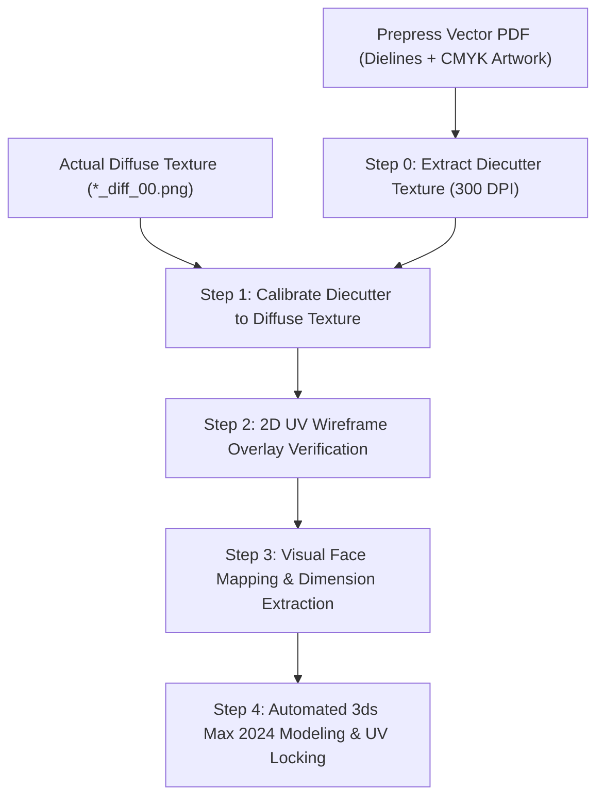
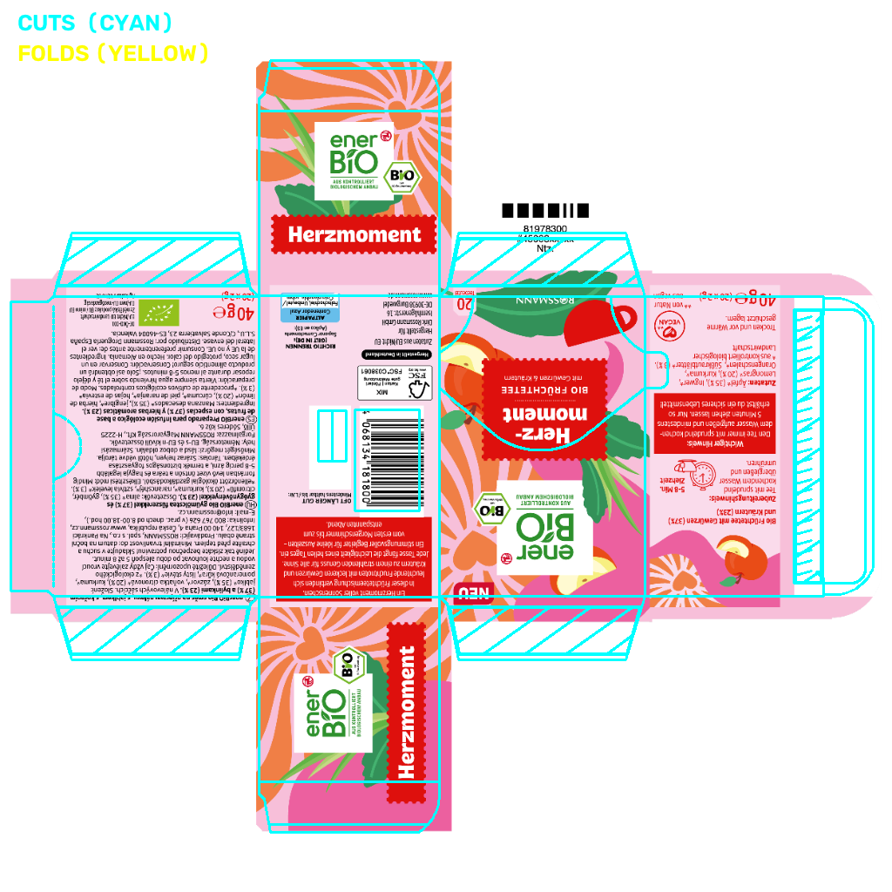

# PDF to Box Package Builder

[](https://www.python.org/)
[](https://pypi.org/project/PyQt6/)
[](https://www.autodesk.com/products/3ds-max)
[](https://github.com/armanpier/pdf-to-box/releases/tag/v1.0.0)
[](LICENSE)

A **deterministic, zero-guesswork packaging automation tool and desktop application** to generate photorealistic 3D folding carton packaging boxes in **Autodesk 3ds Max 2024** directly from prepress vector PDFs (containing diecut cuts and crease lines) and diffuse texture maps (`*_diff_00.jpg` / `.png`).

---

## Why Deterministic UV Alignment?

Traditional 3D workflows rely on manual viewport captures, eye-balling, and trial-and-error UV unwrapping. This introduces:
1. **Perspective Distortion**: 3D viewport angles skew straight crease lines.
2. **Padding Mismatches**: Real-world diffuse textures are square-padded crops of the artwork bleed area, whereas prepress PDFs represent the entire unpadded print sheet.
3. **Seam Artifacts**: Unwrapping after folding causes texture stretching and misaligned panel borders.

**PDF to Box** eliminates guesswork entirely through a **closed-form affine calibration**, **flat planar UV locking**, and **2D wireframe overlay verification**.



---

## 2D UV Wireframe Verification

Instead of guessing from 3D viewport angles, the pipeline draws the exact vector dieline net directly over the diffuse texture:
- **Cuts (outer perimeter, flaps, tuck tongue)**: Drawn in **Cyan** (`#00FFFF`)
- **Creases / Folds (panel hinges)**: Drawn in **Yellow** (`#FFFF00`)



> Confirms in under 0.2 seconds that fold lines land dead-center in panel gutters with sub-pixel precision.

---

## Core Features

- **Modern Desktop GUI (PyQt6)**: Clean 5-step wizard with high-DPI scaling and dark packaging theme.
- **Step 0: High-Res Diecutter Extraction**:
  - Rasterizes PDF dielines at 300 DPI using `pymupdf`.
  - Auto-identifies spot dieline stroke colors (e.g. Pantone Stanze, Cyan DIECUT).
- **Step 1: Multi-Scale Texture Alignment**:
  - **White Crop**: Instant bounding-box match for solid-color / margin-padded packaging.
  - **SIFT Feature Match**: Sub-pixel multi-keypoint alignment for complex artwork textures.
  - **Manual Handles**: Live 4-corner draggable handles (`TL`, `TR`, `BL`, `BR`) with real-time orthogonal transform overlay (no shearing or distortion).
- **Step 2: Interactive 2D UV Overlay**:
  - Zoomable and pannable canvas with full checklist verification.
- **Step 3: Visual Face Mapping**:
  - Auto-detects 4 perimeter body panels and lid flaps.
  - Click on the image or choose from a list to designate the **Front (Hero)** face.
  - Auto-computes millimeter dimensions ($W \times D \times H$).
- **Step 4: 3ds Max 2024 Automation**:
  - Locks planar UV coordinates on the flat net before folding.
  - Applies $0.4\text{ mm}$ quad chamfer modifier and satin paper `PhysicalMaterial` ($0.32$ roughness).
  - Automatically sends and executes script in running 3ds Max 2024 via the Win32 IPC bridge.
  - Saves `.max` scene asset and textures directly into the source PDF directory for 100% portable relative paths.
- **Headless CLI Pipeline**: Full batch/scripting support via `cli.py`.
- **AI Agent Skill**: Ready-to-use skill definition (`SKILL.md`) for Antigravity, Claude, and OpenAI agents.

---

## Mathematical Formulation

The transformation between PDF point coordinates $(x_p, y_p)$ ($1\text{ pt} = \frac{1}{72}\text{ in}$) and texture pixels $(x_t, y_t)$ is solved via:

$$\text{scale}_x = \frac{W_t}{W_p}, \quad \text{scale}_y = \frac{H_t}{H_p}$$

$$\text{offset}_x = x_{0,t} - x_{0,p} \cdot \text{scale}_x, \quad \text{offset}_y = y_{0,t} - y_{0,p} \cdot \text{scale}_y$$

Accounting for the vertical flip between PDF space (origin Top-Left, $+Y$ downwards) and 3ds Max UV space (origin Bottom-Left, $+V$ upwards):

$$\text{scale}_u = \frac{\text{scale}_x}{W_{\text{tex}}}, \quad \text{offset}_u = \frac{\text{offset}_x}{W_{\text{tex}}}$$

$$\text{scale}_v = -\frac{\text{scale}_y}{H_{\text{tex}}}, \quad \text{offset}_v = \frac{H_{\text{tex}} - \text{offset}_y}{H_{\text{tex}}}$$

---

## Installation

### Prerequisites
- Windows 10 / 11
- Python 3.10 or newer
- Autodesk 3ds Max 2024 (optional for headless alignment / verification)

### Setup
```bash
git clone https://github.com/armanpier/pdf-to-box.git
cd pdf-to-box
pip install -r requirements.txt
```

---

## Quick Start

### 1. Launch GUI Application
Double-click `run_app.bat` or run:
```bash
python main.py
```

### 2. Run Headless CLI Pipeline
```bash
python cli.py \
    --pdf package_box.pdf \
    --texture provided_diffuse.png \
    --overlay uv_overlay_check.png \
    --output_ms build_box_package.ms \
    --send_to_max
```

### CLI Options
| Argument | Description | Default |
|---|---|---|
| `--pdf` | Path to prepress vector PDF file | Required |
| `--texture` | Path to diffuse texture map (`*_diff_00.jpg`/`.png`) | Required |
| `--diecutter_texture` | Path to save high-res extracted dieline texture | `<pdf_dir>/diecutter_texture.png` |
| `--overlay` | Path to save 2D UV wireframe overlay check | `<pdf_dir>/uv_overlay_check.png` |
| `--output_ms` | Path to output MaxScript file | `build_box_package.ms` |
| `--send_to_max` | Send script directly to running 3ds Max 2024 | Disabled |

---

## Testing

Run unit tests for core affine math, coordinate transforms, and non-white bounds detection:
```bash
python -m pytest tests/test_core_math.py
```

---

## License

This project is licensed under the [MIT License](LICENSE) - see the LICENSE file for details.
