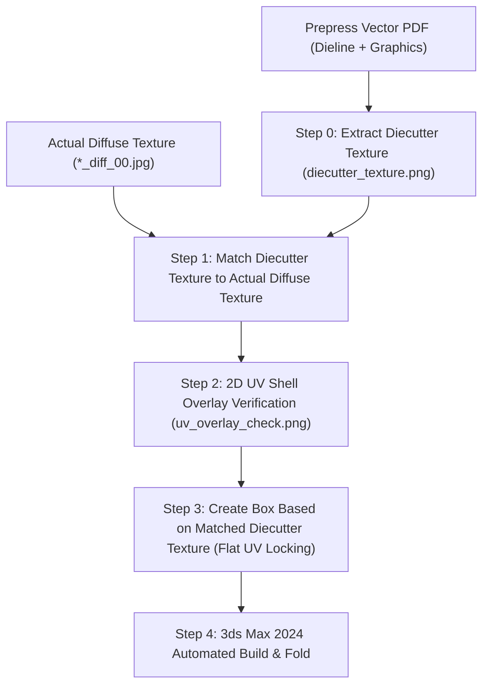

# PDF to Box Package Pipeline

A deterministic, mathematical pipeline to construct photorealistic 3D packaging boxes in **Autodesk 3ds Max 2024** from prepress vector PDFs (containing DIECUT cut and crease lines) and diffuse texture maps (`*_diff_00.jpg` / `.png`).

This workflow avoids perspective distortion and guesswork from 3D viewport captures by enforcing a rigorous pre-modeling texture matching and planar UV locking process.

---

## 5-Step Deterministic Workflow



---

### Step 0: Extract Diecutter Texture from PDF
> [!IMPORTANT]
> **Before doing any 3D modeling**, always extract an image directly from the PDF containing the vector dieline net (cuts, creases, bleed, and artwork).
> We name this master image **`diecutter_texture.png`**.

- The prepress PDF contains vector dielines, fold lines, and CMYK artwork in point units ($1\text{ pt} = \frac{1}{72}\text{ inch}$).
- Render the complete PDF page at high resolution (e.g., 300 DPI or higher) to produce `diecutter_texture.png`. This serves as the un-padded, ground-truth reference for dieline cuts and crease locations.

---

### Step 1: Match Diecutter Texture to Actual Diffuse Texture
> [!IMPORTANT]
> Next, match the extracted **Diecutter Texture** to the **actual diffuse texture** (`*_diff_00.jpg` / `provided_diffuse.png`).
> The matching must calibrate **spacing**, **scale**, and **offsets** so that **all illustrations and text line up 1:1 with the diffuse texture**.

- Actual diffuse textures exported for 3D assets are commonly padded into a square canvas (e.g., $1024 \times 1024$ or $4096 \times 4096$) with white margin bars on the sides and represent only the cropped CMYK bleed area of the packaging.
- The pipeline helper script (`align_pdf_texture.py`) matches the two textures:
  1. Detects the active non-white bleed area in the diffuse texture: $[x_{0,t}, x_{1,t}]$ and $[y_{0,t}, y_{1,t}]$.
  2. Extracts the packaging bleed bounds from the vector PDF artwork layer: $[x_{0,p}, x_{1,p}]$ and $[y_{0,p}, y_{1,p}]$.
  3. Solves the exact affine calibration:
     $$\text{scale}_x = \frac{W_t}{W_p}, \quad \text{scale}_y = \frac{H_t}{H_p}$$
     $$\text{offset}_x = x_{0,t} - x_{0,p} \cdot \text{scale}_x, \quad \text{offset}_y = y_{0,t} - y_{0,p} \cdot \text{scale}_y$$
  4. Converts to normalized UV space ($u, v \in [0, 1]$):
     $$\text{scale}_u = \frac{\text{scale}_x}{W_{\text{tex}}}, \quad \text{offset}_u = \frac{\text{offset}_x}{W_{\text{tex}}}$$
     $$\text{scale}_v = -\frac{\text{scale}_y}{H_{\text{tex}}}, \quad \text{offset}_v = \frac{H_{\text{tex}} - \text{offset}_y}{H_{\text{tex}}}$$

---

### Step 2: 2D UV Shell Overlay Verification
> [!TIP]
> Never verify UV alignment using 3D viewport captures. Viewport screenshots introduce perspective distortion and angle guesswork.

- The script renders the dieline wireframe directly on top of the actual diffuse texture map and saves **`uv_overlay_check.png`**:
  - **Cuts (outer perimeter, flaps, tuck tongue)**: Drawn in **Cyan** (`#00FFFF`).
  - **Creases / Folds (panel hinges)**: Drawn in **Yellow** (`#FFFF00`).
- Inspect `uv_overlay_check.png` to confirm:
  1. Fold lines fall directly down the center of vertical gutters between language panels.
  2. Top horizontal fold line lands right between the top lid artwork and the front panel header.
  3. Bottom horizontal fold line lands right between the front panel branding and the barcode flap.
  4. No illustrations or text blocks intersect fold or cut lines.

---

### Step 3: Create Box Based on Matched Diecutter Texture (Flat UV Locking)
- Now that the diecut geometry and lines are matched to the diffuse texture, **create the box based on the matched diecut texture**:
- Generate the flat 2D mesh directly from the PDF vector dieline net on the flat ground plane ($Z = 0$).
- Assign planar UV coordinates to every vertex while the mesh is completely flat:
  $$u = x_{pt} \cdot \text{scale}_u + \text{offset}_u$$
  $$v = y_{pt} \cdot \text{scale}_v + \text{offset}_v$$
- When the panels fold 90° into the 3D volume, the planar UV coordinates remain locked on the vertices, ensuring zero distortion, zero stretching, and zero seam artifacts.

---

### Step 4: 3ds Max 2024 Automated Build & Fold (Same-Folder Saving)
- Generates and executes MaxScript to:
  1. Set system units to Millimeters (`units.SystemType = #Millimeters`, `units.SystemScale = 1.0`).
  2. Create the box geometry with exact millimeter dimensions matching the PDF dieline.
  3. Assign the locked planar UV coordinates to map vertices.
  4. Apply a quad-chamfer modifier ($0.4\text{ mm}$ radius, 2 segments) for realistic cardstock highlights.
  5. Assign a `PhysicalMaterial` with satin paper roughness ($0.32$) and diffuse bitmap.
  6. **Save `.max` scene asset and textures directly in the same folder as the input PDF file**:
     - Resolves destination directory: `pdf_dir = os.path.dirname(os.path.abspath(args.pdf))`
     - Ensures diffuse texture (`provided_diffuse.png` / `*_diff.png`) and diecutter textures reside in `pdf_dir`.
     - Executes `saveMaxFile` directly to `<pdf_dir>/<pdf_stem>.max` and `<pdf_dir>/package_box.max`, guaranteeing 100% portable relative texture linking.

---

## Usage

### Run from Command Line
```bash
python .agent/skills/pdf_to_box_package/scripts/align_pdf_texture.py \
    --pdf package_box.pdf \
    --texture provided_diffuse.png \
    --diecutter_texture diecutter_texture.png \
    --overlay uv_overlay_check.png \
    --output_ms build_box_package.ms \
    --send_to_max
```

### CLI Arguments
- `--pdf`: Path to prepress vector PDF file (default: `package_box.pdf`).
- `--texture`: Path to actual diffuse texture map (default: `provided_diffuse.png`).
- `--diecutter_texture`: Path to save the extracted diecutter texture image (default: `diecutter_texture.png`).
- `--overlay`: Output path for the 2D UV overlay verification image (default: `uv_overlay_check.png`).
- `--output_ms`: Output path for the generated MaxScript file (default: `build_box_package.ms`).
- `--send_to_max`: Flag to send and execute the script directly in running 3ds Max 2024 via the Win32 IPC bridge.
